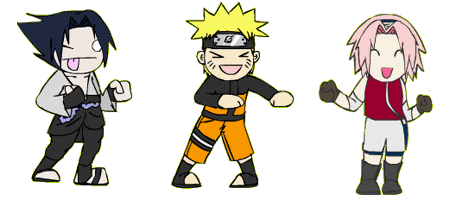
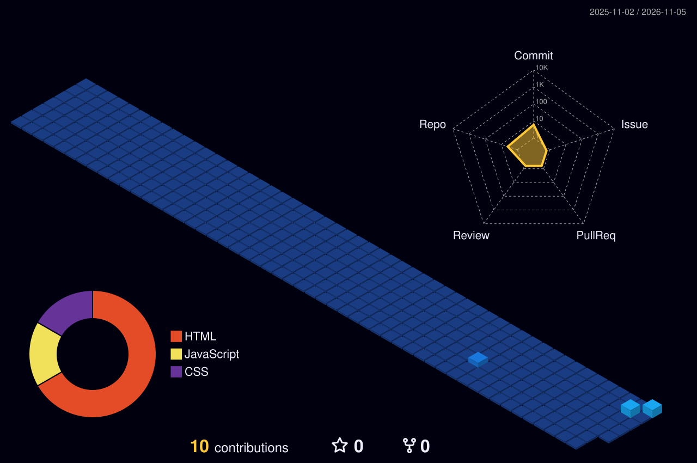

<!-- 🎬 HERO BANNER WITH VIEW-FINDER & CYCLING ROLES -->

  

 

<!-- 🍥 MY NINJA WAY -->

  

<!-- 🔦 JUTSU ARSENAL -->

  

<!-- 🪪 NINJA REGISTRATION + MISSION DASHBOARD -->

  

## 🍥 S-Rank Missions

<table>
<tr><th>Mission</th><th>What it is</th><th>Jutsu used</th><th align="center">Rank</th></tr>
<tr><td><a href="https://github.com/dipeshmaurya08-dot"><b>BuddyVerse3D</b></a></td><td>Interactive 3D Virtual Universe & Metaverse Experience</td><td><code>Unity</code> <code>WebGL</code> <code>C#</code> <code>Three.js</code></td><td align="center"><b>S</b></td></tr>
<tr><td><a href="https://github.com/dipeshmaurya08-dot"><b>Itachi — Uchiha Experience</b></a></td><td>Cinematic web experience — scroll scrub, Sharingan eye tracking & jutsu cards</td><td><code>JavaScript</code> <code>CSS</code> <code>WebGL</code></td><td align="center"><b>S</b></td></tr>
<tr><td><a href="https://github.com/dipeshmaurya08-dot/cyber"><b>cyber</b></a></td><td>Modern cybersecurity, tooling & interactive scripts</td><td><code>JavaScript</code> <code>Node.js</code></td><td align="center"><b>A</b></td></tr>
<tr><td><a href="https://github.com/dipeshmaurya08-dot/cyberweb"><b>cyberweb</b></a></td><td>Clean, responsive cyber architecture and web interfaces</td><td><code>HTML5</code> <code>CSS3</code></td><td align="center"><b>A</b></td></tr>
<tr><td><a href="https://github.com/dipeshmaurya08-dot/dipesh-mistry"><b>dipesh-mistry</b></a></td><td>Interactive creative frontend & UI design showcase</td><td><code>CSS</code> <code>JavaScript</code></td><td align="center"><b>B</b></td></tr>
</table>

<a href="https://github.com/dipeshmaurya08-dot?tab=repositories"><b>→ See all repositories on GitHub</b></a>

  

### 🌃 My contribution village

*Every commit raises another building — rebuilt automatically every day.*

  

<!-- 💌 JOIN THE SQUAD -->

  

 

**Dattebayo — keep coding, keep growing. 🍥**

